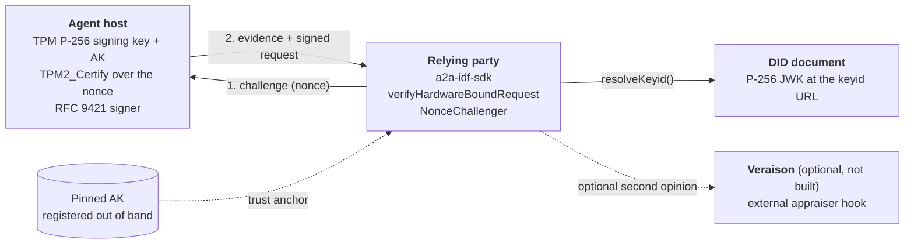

# Hardware-key path (TPM 2.0, ECDSA P-256)

An optional second key type next to the default Ed25519 software key. The signing key is a P-256 key generated inside a TPM 2.0 that cannot be exported. A relying party can check, for a challenge it issued, that the key signing a request is that TPM-resident key. The Ed25519 path is unchanged.

> **What this is not.** The reference setup runs on a *virtual* TPM (Hyper-V vTPM, or swtpm). That proves the flow end to end; it does not resist an attacker with physical access, and a virtual TPM's endorsement chain leads to the hypervisor vendor, not a chip manufacturer. Read [Limitations](#limitations) before relying on this.

## Roles

The flow follows the RFC 9334 background-check model.

| Role | Played by |
|---|---|
| Attester | The agent host with the TPM (`TpmHost`) |
| Relying party | The service verifying requests (`verifyHardwareBoundRequest`); it also issues challenges |
| Verifier | The SDK's own appraisal. An external verifier such as Veraison can be added as a second opinion ([Veraison](#veraison)) |

## Architecture



The SDK's own appraisal is the verifier. Veraison is drawn dashed because it is an optional hook that is not implemented; see [Veraison](#veraison).

## Flow

1. The relying party issues a fresh single-use nonce (`NonceChallenger.issue()`, 32 random bytes, 60 s TTL by default).
2. The host runs `TPM2_Certify`: an attestation key (AK) signs a statement about the signing key, with the nonce as qualifying data. The nonce is inside the signed structure; a nonce attached afterwards would prove nothing.
3. The host signs the HTTP request with the signing key (RFC 9421, `ecdsa-p256-sha256`), using the same nonce, base64url-encoded, as the signature's `nonce` parameter.
4. The host sends the request with an evidence bundle.
5. The relying party resolves the keyid, verifies the signature, then verifies that the evidence binds that same key to that nonce under a pinned AK. The nonce is consumed only if every check passes.

```mermaid
sequenceDiagram
    autonumber
    participant H as Agent host (TPM)
    participant R as Relying party (SDK)
    participant D as DID document

    rect rgb(30, 60, 40)
    Note over H,R: Run 1: original hardware key, PASS
    R->>H: challenge (fresh nonce)
    H->>R: Certify evidence + signed request (nonce in both)
    R->>R: AK pinned for this keyid?
    R->>D: resolveKeyid()
    D-->>R: P-256 JWK
    R->>R: verify signature, then key binding and nonce
    R-->>H: PASS (nonce consumed)
    end

    rect rgb(60, 30, 30)
    Note over H,R: Run 2: software key (including a copied key), FAIL
    R->>H: challenge (fresh nonce)
    H->>R: signed request, no evidence
    R-->>H: FAIL evidence-missing
    Note over H,R: 2b: a software key presenting the TPM key's evidence fails jwk-mismatch
    end

    rect rgb(60, 30, 30)
    Note over H,R: Run 3: replayed evidence, FAIL
    R->>H: challenge (new nonce)
    H->>R: old evidence + signed request
    R-->>H: FAIL nonce-mismatch
    end
```



Not shown: a live relay of a legitimate host's fresh request and evidence to the same target is not detected ([Limitations](#limitations)).

## Relying party

```ts
import { NonceChallenger, verifyHardwareBoundRequest } from "@opena2a/a2a-idf";

const challenger = new NonceChallenger({ ttlSeconds: 60 });

// POST /challenge
const nonce = challenger.issue();
reply({ nonce: Buffer.from(nonce).toString("base64url") });

// POST /a2a
const result = await verifyHardwareBoundRequest({
  request: {
    method: req.method,
    authority: req.headers.host, // exactly as received
    path: req.url,
    body: bodyBytes,
    headers: {
      "content-digest": req.headers["content-digest"],
      "signature-input": req.headers["signature-input"],
      signature: req.headers.signature,
    },
    evidence: req.headers["tpm-evidence"], // header name is up to you
  },
  challenger,
  // Trusted AK per keyid. Returning undefined rejects before the keyid URL is fetched.
  pinnedAk: (keyid) => pinnedAks.get(keyid),
});
if (!result.ok) {
  // result.reason, see "Failure reasons"
}
```

The AK must be pinned out of band (for example at registration time). The evidence bundle carries its own copy of the AK public key, but only to be compared against the pin; it is never trusted on its own.

## Host (attester)

Needs [tpm2-tools](https://github.com/tpm2-software/tpm2-tools) and access to `/dev/tpmrm0` (membership of the `tss` group). `TpmHost` is a separate entry point so the main package does not import `child_process`.

```ts
import { signEcdsaP256, encodeEvidenceBundle } from "@opena2a/a2a-idf";
import { TpmHost } from "@opena2a/a2a-idf/tpm-host";

const host = new TpmHost();
const { jwk, akPem } = await host.provision();
// Publish `jwk` in the DID document at the keyid URL.
// Give `akPem` to the relying party to pin, out of band.

const evidence = encodeEvidenceBundle(await host.certify(nonceBytes));
const headers = await signEcdsaP256(
  { method, authority, path, body, params: { keyid, created, expires, nonce: nonceB64u } },
  host.signer, // raw r||s from the TPM
);
```

`provision()` creates an AK and a signing key under a fresh primary and persists them at `0x81010010` and `0x81010011` (override with `akHandle` / `keyHandle`). It refuses to overwrite an occupied handle unless called with `{ replace: true }`. `release()` evicts both.

Stock `tpm2_certify` (5.7) cannot carry a qualifying-data nonce: it hardcodes `extraData` to `00ff55aa`. `TpmHost.certify()` therefore builds the `TPM2_Certify` command itself and sends it with `tpm2_send`.

### Publishing the key

Publish the P-256 key as a JWK in a DID document served at the keyid URL with content type `application/did+json`:

```json
{
  "id": "did:web:agent.example",
  "verificationMethod": [{
    "id": "did:web:agent.example#k",
    "type": "JsonWebKey2020",
    "controller": "did:web:agent.example",
    "publicKeyJwk": { "kty": "EC", "crv": "P-256", "x": "...", "y": "..." }
  }],
  "assertionMethod": ["did:web:agent.example#k"]
}
```

The compact form (`{ "address": ..., "public_key": "<PEM SPKI>" }`) also accepts a P-256 key. `resolveKeyid()` reports which algorithm it found in `ResolvedKey.algorithm` (`"ed25519"` or `"ecdsa-p256-sha256"`) and returns a P-256 key as the 65-byte uncompressed point. Check `algorithm` and use the matching verifier.

## Wire formats

**Signature.** `Signature-Input` is exactly, in this order:

```
sig1=("@method" "@authority" "@path" "content-digest");created=N;expires=N;keyid="...";alg="ecdsa-p256-sha256";nonce="..."[;tag="..."]
```

Any other component set, order or parameter is rejected, so coverage cannot be stripped. The signature value is raw `r‖s`, 64 bytes (RFC 9421 §3.3.4), never ASN.1 DER. TPM tools emit DER or `TPMT_SIGNATURE`; `signEcdsaP256` refuses a signer that returns anything but 64 bytes, and `TpmHost.signer` converts for you.

**Evidence bundle.** A JSON object, `{"v":1,"certInfo":...,"certSignature":...,"keyPublic":...,"akPublic":...}`, each field unpadded base64url: the `TPMS_ATTEST` from Certify, the AK's `TPMT_SIGNATURE` over it, the signing key's `TPM2B_PUBLIC`, and the AK public key as SPKI DER. Decoding is strict: exact field set, canonical base64url, at most 4 KiB per field and 16 KiB in total.

## What the relying party checks

In this order, stopping at the first failure:

1. `Signature-Input` is the P-256 profile.
2. Evidence is present and well formed.
3. An AK is pinned for this keyid.
4. The keyid resolves to a P-256 key.
5. The request signature verifies, and `created`, `expires` and body digest are valid.
6. The evidence binds that key to the nonce, under the pinned AK:
   - the AK's signature over the Certify structure verifies;
   - the TPM name recomputed from the key's `TPM2B_PUBLIC` equals the certified name inside the signed structure;
   - the key has `fixedTPM`, `fixedParent`, `sensitiveDataOrigin` and `sign` set, so it is non-exportable and was generated by the TPM;
   - the nonce inside the signed structure equals the nonce the relying party issued;
   - the key's X and Y equal those of the published JWK.
7. If an `appraiser` is configured, it also accepts.

A valid signature alone proves possession of a P-256 key, which a software key also has. Steps 2 and 6 are what separate a hardware-bound key from a software one.

## Failure reasons

| Situation | `reason` |
|---|---|
| No evidence (software Ed25519 or P-256 key, or no Certify) | `evidence-missing` (or `malformed-signature-input` / `key-algorithm-not-p256` for an Ed25519 request or key) |
| Software key presenting someone else's TPM evidence | `jwk-mismatch` |
| Old evidence against a new challenge | `nonce-mismatch` |
| Request or evidence replayed after success, or nonce expired or never issued | `nonce-unknown` |
| AK not the pinned one | `ak-not-pinned` |
| Tampered Certify structure or wrong AK signature | `ak-signature-invalid` |
| Certified name does not match the key | `name-mismatch` |
| Key missing fixedTPM / fixedParent / sensitiveDataOrigin / sign | `key-not-hardware-bound` |
| Body altered after signing | `content-digest-mismatch` |
| Signature by a different key than the published one | `signature-invalid` |
| External appraiser rejects or throws | `appraisal-rejected` / `appraisal-failed` |

The full set is the `HardwareBoundFailureReason` type.

## Limitations

- **The AK is pinned as the trust anchor.** There is no endorsement-key (EK) certificate chain and no `TPM2_ActivateCredential`, so nothing proves the AK lives in the same TPM, or in a genuine TPM at all. Whoever controls the pinned AK can certify any key. A later version should add EK-based AK enrollment.
- **Virtual TPM.** The reference setup does not resist physical attackers (see the note at the top).
- **No relay resistance.** An attacker who forwards a legitimate host's fresh request and evidence to the same target is not detected. Nonce freshness only stops replays.
- **Challenge storage is in memory.** `NonceChallenger` is single-process, like `ReplayCache`. Behind a load balancer, use a shared store with the same issue, check and consume semantics. At capacity it drops the oldest outstanding challenge, so rate limit the challenge endpoint.
- **`@authority`** is lowercased but not otherwise normalized (default ports are not stripped). Pass the host exactly as received.
- **High-s ECDSA signatures** are accepted.
- **A DID document with several keys** uses the key referenced by `assertionMethod`, else the first supported verification method.

## Veraison

[Veraison](https://github.com/veraison/services)'s built-in TPM scheme, `tpm-enacttrust`, appraises a `TPM2_Quote` (a signature over a PCR digest compared with a reference value). It does not appraise a `TPM2_Certify` of a signing key, so it cannot perform the key-binding checks above. A third-party write-up (arXiv 2608.03534) also reports that the scheme does not compare the quote's qualifying data with the session nonce; we have not verified that against the Veraison source. The SDK therefore does its own appraisal and treats Veraison as optional: pass an `EvidenceAppraiser` to `verifyHardwareBoundRequest` and it runs after every local check, can only reject, and rejects when it throws. A Veraison client would need a custom scheme or a separate quote flow.

## Tests

The unit tests run everywhere. Two suites need a real TPM and skip themselves without one: `test/tpm/host.e2e.test.ts` (host against the TPM) and `test/tpm/e2e.http.test.ts` (a relying-party HTTP server and an agent client, covering the three demo runs and the replay, expiry and tamper negatives). They need `/dev/tpmrm0` readable and writable (the `tss` group), tpm2-tools, and use persistent handles `0x81010020`/`0x81010021` and `0x81010030`/`0x81010031`, which they remove afterwards.

```bash
npx vitest run test/tpm
```

`test/tpm/fixtures/vtpm-p256.json` holds output captured from a Hyper-V vTPM with throwaway keys.
